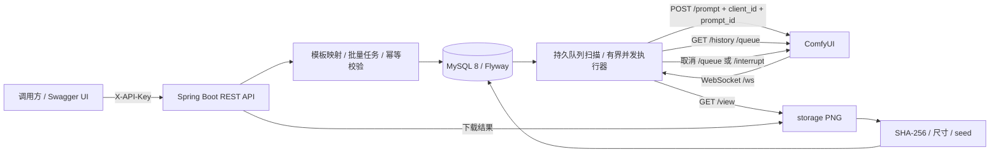
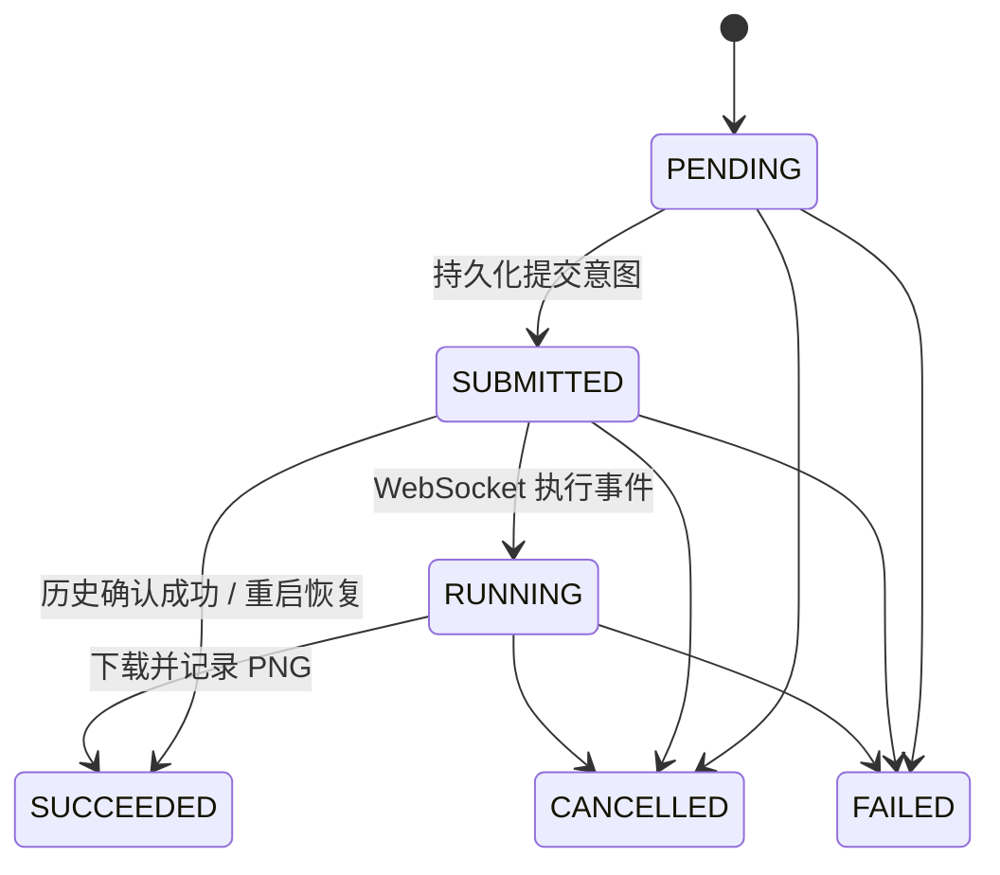

# ComfyBatchService — ComfyUI 批量生图任务后台

Java / Spring Boot 作品集 Demo：将 ComfyUI API 工作流变成可追踪的批量任务，展示 MySQL 持久队列、WebSocket 进度、失败重试、图片落盘及重启恢复。第一版采用单服务实例，不包含前端。

功能基线见 [v1 报告](reports/20261022-v1-report.md)，可读性重构与兼容回归见 [v1.1 报告](reports/20261022-v1.1-refactor-report.md)。报告区分自动化测试、真实环境实测及未验证事项。

## 架构



- `cb_template`：API 工作流及参数映射；`cb_job`：批量请求和唯一幂等键。
- `cb_task`：子任务、实际 seed、进度、执行次数、下次执行时间及取消意图。
- `cb_event`：状态变更及原因；`cb_attempt`：每次执行的 prompt_id、错误和起止时间。
- `cb_result`：本地相对路径、sha256、图片尺寸及 seed。
- `cb_flyway_schema_history`：本项目迁移版本。不会改动 MySQL 服务配置。



重试属于子任务内部的执行尝试：失败时记录 `cb_attempt.error` 和同状态事件，不将终态 FAILED 改回 PENDING。首次执行加最多 3 次重试，共 4 次；默认退避 1、2、4 秒。仅耗尽后进入 FAILED。`SUBMITTED` 表示已持久化提交意图，HTTP 拒绝时也保留该状态等待重试。进度来自当前节点，不是整张图的严格线性百分比。

## 10 分钟阅读路线（v1.1）

| 顺序 | 文件 | 重点 |
|---|---|---|
| 1 分钟 | `api/BatchController.java`、`api/ApiModels.java` | HTTP 入口与 record 请求/响应；Controller 不包含 SQL |
| 2 分钟 | `service/JobService.java`、`WorkflowParameters.java` | 幂等判断、事务内创建批次、映射参数和 seed |
| 3 分钟 | `service/TaskWorker.java` | `run → submit/reconcile → pollUntilDone → complete/handleFailure` |
| 2 分钟 | `TaskRecovery.java`、`TaskLifecycle.java`、`TaskFailureHandler.java` | 恢复判断、JVM 全局锁、状态机与退避 |
| 2 分钟 | `repository/*Repository.java`、`comfy/ComfyClient.java` | 六张业务表的 SQL/RowMapper 与远端协议 |

以上路径均相对于 `src/main/java/dev/comfybatch/`。`domain` 包保存明确类型的领域对象；`config/AppProperties` 集中绑定原有配置；`support/Json` 仅提供 JSON 与哈希工具。

所有 Java 代码用 Spotless + google-java-format AOSP（4 空格）格式化。验收命令：

```bash
./scripts/mvn.sh spotless:check test
```

`ApiContractTest` 补充检查旧响应的字段名、扁平结构及 HTTP 状态。v1.1 按任务要求统一错误体为 `code/message/details`；这项错误 JSON 格式是明确的接口变化，成功响应、状态码及业务规则保持兼容。客户端如解析旧 `error` 字段需要调整。异常原因保留在服务日志或安全的错误说明中，响应不包含 SQL 和内部堆栈。

维护者可选运行 `python3 scripts/java_metrics.py --check` 检查 AST 方法长度、行宽及变量名；需把 `tree-sitter==0.23.2` 和 `tree-sitter-java==0.23.5` 安装到项目 `.tools/metrics`，不属于服务运行依赖。

## 环境与启动

需要 Java 21、Maven、MySQL 8 和可访问的 ComfyUI（带 API 默认节点和现有 checkpoint）。依赖版本固定为 Spring Boot 3.5.13、springdoc 2.8.17；兼容范围参见 [springdoc 官方文档](https://springdoc.org/v2/)。

1. 复制 `.env.example` 为 `.env`，填写数据库配置和非空随机 `API_KEY`。已有 `.env` 请直接补配置，不要覆盖。
2. 启动自己的 ComfyUI，确认 `/prompt`、`/history/{prompt_id}`、`/view`、`/ws` 可用。设置 `COMFY_URL`。工作流中的 checkpoint 名称必须与该实例一致。
3. 运行：

```bash
./scripts/mvn.sh test
./scripts/mvn.sh -DskipTests package
./scripts/run.sh
```

脚本优先使用项目内 `.tools/jdk21/Contents/Home`，没有该目录则使用系统 Java。Maven 缓存在 `.tools/m2`，通过项目内配置使用 HTTPS Maven Central，不改系统 Maven 配置。测试使用 H2 MySQL 兼容模式和 MockWebServer，不连接真实数据库。

启动时从 `.env` 导入配置；首次连接数据库会由 Flyway 创建 `cb_*` 表。API 默认仅监听 `127.0.0.1:8080`。Swagger UI：<http://127.0.0.1:8080/swagger-ui.html>，点击 Authorize 输入 API Key。OpenAPI JSON：<http://127.0.0.1:8080/v3/api-docs>。

| 配置 | 默认值 | 含义 |
|---|---|---|
| DB_HOST / DB_PORT / DB_NAME / DB_USER / DB_PASSWORD | 见示例 | MySQL 连接 |
| API_KEY | 无，必须设置 | X-API-Key |
| COMFY_URL | http://127.0.0.1:8188 | ComfyUI 基础 URL |
| CONCURRENCY | 1 | 同时在途子任务数，1–16 |
| TASK_TIMEOUT_SECONDS | 600 | 每次执行尝试的超时 |
| RETRY_BASE_MS | 1000 | 指数退避基数 |
| POLL_MS | 1000 | 历史轮询间隔，至少 50ms |
| STORAGE_DIR | storage | 结果图片目录 |
| SERVER_PORT | 8080 | 后台端口 |
| WORKER_ENABLED | true | 是否自动执行队列 |

本机检查发现的 Comfy Desktop 位于 `/Applications/AI/Comfy Desktop.app`，核心实例在 `/path/to/ComfyUI`。本次使用其 `.venv/bin/python`，通过 `--base-directory` 将运行目录指向本项目 `.runtime/comfy`，只读使用共享模型；禁用 custom nodes、manager 和外网节点。具体环境与沙箱/MPS 差异见报告。不要将这些本机绝对路径作为其他机器的安装路径。

本机重新启动已验证的 ComfyUI（在单独终端运行）：

```bash
./scripts/start-comfy.sh "/path/to/ComfyUI" "/path/to/models"
```

脚本不安装依赖、不下载模型；其他机器需传入自己的路径，必要时指定 `COMFY_PYTHON`。本次验收结束后，Java 和临时 ComfyUI 服务均已停止。

### 他人在本机复现 MySQL

仓库提供 `docker-compose.yml`，固定 `mysql:8.0.46`。仅供有 Docker 的其他机器使用。本次 Mac 未安装 Docker，也没有执行该 Compose。

```bash
# 配置 .env 的 DB_HOST=127.0.0.1 和 DB_PORT 等字段后
# 仅在已安装 Docker 的复现机器运行：
docker compose up -d mysql
```

现有虚拟机不需要执行此命令，继续使用原 `.env` 连接。不要将 Compose 用于覆盖原数据库配置。

## API 示例

以下 `$API_KEY` 是你在终端手动设置的变量，示例不包含真实密钥。避免 `set -x` 或将密钥写进共享日志。

### 创建模板

上传 API 格式 JSON，而不是 ComfyUI UI 的 nodes/links 导出格式。包装格式为 `name`、`workflow`、`mappings`；映射必须包含 prompt、negative_prompt、seed、width、height、steps。示例使用已有 SDXL checkpoint。

```bash
curl -sS http://127.0.0.1:8080/api/templates \
  -H "X-API-Key: $API_KEY" -H 'Content-Type: application/json' \
  --data-binary @examples/template.json
```

返回 `{"id":"模板 UUID"}`。工作流中的具体节点类型由 ComfyUI 验证；后端检查参数映射的节点/input 是否存在，允许远端节点验证错误进入重试和错误审计流程。

### 提交批量任务

```bash
curl -sS http://127.0.0.1:8080/api/jobs \
  -H "X-API-Key: $API_KEY" -H 'Content-Type: application/json' \
  -H 'Idempotency-Key: demo-batch-001' \
  -d '{"templateId":"模板 UUID","parameters":{"prompt":"a ceramic teapot on a wooden table","negative_prompt":"blurry","width":512,"height":512,"steps":20},"count":5,"seeds":[101,102,103,104,105]}'
```

返回 `{"id":"批次 UUID","replayed":false}`。相同键和相同请求返回同一批次、`replayed=true`；相同键不同请求返回 409。JSON 对象字段顺序不影响判断。无幂等键时每次创建新批次。数量限制 1–100；显式 seeds 长度须等于 count，否则由参数 seed 逐个加一或生成随机非负 long。seed 使用 Java signed long 的非负范围。

### 查询、取消、下载

```bash
curl -sS -H "X-API-Key: $API_KEY" 'http://127.0.0.1:8080/api/jobs?page=0&size=20&state=RUNNING'
curl -sS -H "X-API-Key: $API_KEY" http://127.0.0.1:8080/api/jobs/批次UUID
curl -sS -H "X-API-Key: $API_KEY" http://127.0.0.1:8080/api/tasks/子任务UUID
curl -sS -X POST -H "X-API-Key: $API_KEY" http://127.0.0.1:8080/api/tasks/子任务UUID/cancel
curl -sS -X POST -H "X-API-Key: $API_KEY" http://127.0.0.1:8080/api/jobs/批次UUID/cancel
curl -sS -H "X-API-Key: $API_KEY" http://127.0.0.1:8080/api/results/结果UUID/file -o result.png
```

子任务详情含进度、attempts、events、results。列表 `state` 按“包含该状态子任务”筛选批次；批次聚合状态优先 RUNNING、PENDING，全部结束后若含失败则 FAILED，混合成功/取消为 CANCELLED。取消返回 202：本地等待任务立即取消；远端任务先保存取消意图，再查询队列后删除 pending prompt 或 interrupt 当前匹配的 running prompt，并等待远端确认。若完成先于取消，成功结果保留。

## 测试与证据

- `JobScenarioTest`：状态机、参数校验回滚、映射/seed、幂等与冲突、指数退避和重试上限、WS 消息、取消。
- `RecoveryScenarioTest`：真实 WS 模拟握手、WS 不可用时从 history 恢复且不重提、历史/队列都丢失时安排重试、只删除目标 queued prompt、超时 interrupt 后重试、网络不可达时保留 prompt_id。
- `scripts/probe_comfy.py`：本次第 0 步检查脚本，读取本机已有 ComfyUI 示例；记录四接口交互和 PNG。
- `scripts/probe_mysql.py`：只读连接验证。该脚本使用 `.tools/mysql-probe` 的 PyMySQL（验收辅助工具，非服务运行依赖）。
- `scripts/e2e.py`：连接真实数据库和 ComfyUI；创建验收数据、启动并重启自身管理的 Java 进程；日志不保存鉴权请求头。只在明确需要真实验收时运行，会消耗生图资源并留下业务记录和图片。
端到端验收的原始证据未随公开仓库发布，验收结论见 reports/ 下的报告

## 已知限制

1. 单 JVM 实例的持久队列。没有数据库分布式锁，不允许多实例共享同一库调度。并发参数控制本服务的在途任务数，ComfyUI 通常仍按自身队列串行执行。
2. `/interrupt` 是 ComfyUI 全局接口；本实现先核对 running prompt，再调用 interrupt，但两次请求之间仍有竞态。Demo 应使用专属 ComfyUI 实例，不与人工或其他服务混用。
3. 数据库和 ComfyUI HTTP 之间没有分布式事务。提交前保存 prompt_id 降低崩溃窗口；历史/队列都丢失时无法严格证明是否执行过，重试可能造成远端重复生成。不是 exactly-once。网络不可达时保留 prompt_id 等待恢复，不能声称远端已取消；持续不可达可能超出名义超时时间。
4. WebSocket 只用于进度，完成结果以历史为准；当前同时保持轮询，断线无需等待重连即可继续。重启后重新建立 WS。没有向调用方推送 SSE/WebSocket。
5. 结果仅支持 PNG，存储在本机；不提供对象存储、备份、垃圾清理或磁盘配额。复制部署需同时保留数据库与 storage。
6. 模板由持有 API Key 的可信调用方上传，不对任意 ComfyUI 工作流提供安全沙箱。多输出节点可能产生多张结果；seed 字段记录映射到采样器的值，复杂多采样器/内部随机节点须由模板作者保持语义一致。
7. API Key 是 Demo 的单密钥鉴权；默认仅本机监听。Swagger/OpenAPI 文档公开可读，业务接口需要密钥。没有用户隔离、密钥轮换管理或限流。
8. H2 不能替代全部 MySQL 语义验证。Compose 文件本次未运行，其他硬件/模型、远程 TLS、长期运行和负载压力未验收。

## 后续规划（本版不实现）

前端页面、多用户体系、云 GPU 对接、LoRA 训练、视频生成；以及多实例调度租约、对象存储和更完整的监控告警。

## 开发说明

本项目在 AI 编程工具辅助下实现；需求与验收标准、代码审查与重构要求、环境搭建、断点调试与崩溃恢复验证由作者负责，最大重试次数配置化由作者亲手实现。

许可证：MIT，见 [LICENSE](LICENSE)。
